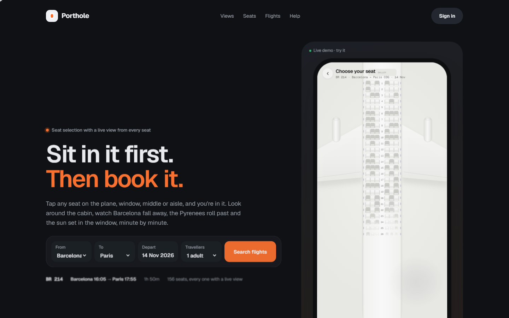

<div align="center">


# Porthole

**Sit in it first. Then book it.**

Airline seat selection with a live, interactive 3D view from every seat on the plane.

[](https://thealta.github.io/Porthole/porthole-seat-view.html)
[](LICENSE)


[**Live demo**](https://thealta.github.io/Porthole/porthole-seat-view.html) ·
[Report a bug](https://github.com/TheAlta/Porthole/issues/new?template=bug_report.md) ·
[Request a feature](https://github.com/TheAlta/Porthole/issues/new?template=feature_request.md)

<br>



</div>

---

## Table of contents

- [About](#about)
- [Features](#features)
- [How it works](#how-it-works)
- [Tech stack](#tech-stack)
- [Getting started](#getting-started)
- [Project structure](#project-structure)
- [Browser support](#browser-support)
- [Roadmap](#roadmap)
- [Contributing](#contributing)
- [License](#license)

## About

Choosing a seat on a booking site usually means staring at a grid of squares and guessing.
Is 11A really next to a window? What will I see from the middle seat? Where is the sun at 17:00?

**Porthole** answers that before you pay. Tap any seat on a 156-seat Airbus A320 and you are
*in* it — look around the cabin, drag the flight forward and watch Barcelona fall away,
the Pyrenees roll past, the sun set in the window and Paris light up below, minute by minute.

> Demo flight: **BR 214 · Barcelona (BCN) 16:05 → Paris (CDG) 17:55 · 1h 50m**

## Features

| | |
|---|---|
| 🪑 **Interactive seat map** | Full A320 cabin, 26 rows, seats A–F. Even taken seats can be previewed. |
| 🌍 **Live 3D seat view** | Real-time Three.js scene from the exact seat you tapped — drag to look around. |
| ⏱️ **Flight timeline** | Scrub through takeoff, cruise over the Pyrenees, sunset, descent and touchdown. Cabin light changes with time of day. |
| 🪟 **Window shade** | Pull the shade down yourself on window seats (mouse, touch or keyboard). |
| 🚶 **Walk the cabin** | Switch between seats A–F or step a row forward/back; the camera walks you there. |
| ⚠️ **"No window" warning** | Flags window seats that only face a wall panel — before you pay for them. |
| 🌓 **Light & dark themes** | Follows the system preference, built on CSS custom properties. |
| 📱 **Responsive** | Works on phones, tablets and desktops, with safe-area support for notched devices. |
| ♿ **Accessible controls** | Sliders and buttons are keyboard-reachable with ARIA roles and labels. |

## How it works

1. **Tap any seat** — window, middle or aisle.
2. **Drag the flight forward** — the plane climbs through cloud between views, and the light in the cabin changes.
3. **Move through the cabin** — switch seats or rows and compare views side by side.

## Tech stack

| Layer | Technology |
|---|---|
| Markup & styling | Semantic HTML5, modern CSS (custom properties, `color-mix`, grid, `prefers-color-scheme`) |
| 3D rendering | [Three.js r128](https://threejs.org/) (WebGL) |
| Smooth scrolling | [Lenis 1.1](https://github.com/darkroomengineering/lenis) |
| Typography | [Geist & Geist Mono](https://vercel.com/font) via Google Fonts |
| Logic | Vanilla JavaScript — no framework, no bundler |

Everything ships in **one self-contained HTML file**; images are embedded, and the only
network requests are the two CDN libraries and the web fonts.

## Getting started

No install, no build step.

**Option 1 — open the file**

```bash
git clone https://github.com/TheAlta/Porthole.git
cd Porthole
```

Then double-click `porthole-seat-view.html`.

**Option 2 — run a local server** (recommended for consistent WebGL behavior)

```bash
# Node
npx serve .

# or Python
python -m http.server 8000
```

Open <http://localhost:8000/porthole-seat-view.html>.

## Project structure

```
Porthole/
├── porthole-seat-view.html   # The whole app: markup, styles, scripts and embedded assets
├── docs/
│   ├── logo.svg              # Project logo
│   └── screenshots/          # Images used in this README
├── .github/                  # Issue & pull request templates
├── CHANGELOG.md
├── CONTRIBUTING.md
├── CODE_OF_CONDUCT.md
├── SECURITY.md
└── LICENSE
```

## Browser support

Any evergreen browser with WebGL:

| Chrome | Edge | Firefox | Safari | iOS Safari | Android Chrome |
|:---:|:---:|:---:|:---:|:---:|:---:|
| ✅ | ✅ | ✅ | ✅ 16.2+ | ✅ 16.2+ | ✅ |

## Roadmap

- [x] Seat map and live 3D seat view for BCN → CDG
- [x] Flight timeline with time-of-day lighting
- [ ] More routes (Tehran, Istanbul, Dubai, Kish)
- [ ] Wide-body aircraft layouts (A350, 787)
- [ ] Real sun position from departure time and heading
- [ ] Share a link to a specific seat and moment

See the [open issues](https://github.com/TheAlta/Porthole/issues) for proposed features and known issues.

## Contributing

Contributions are welcome! Please read [CONTRIBUTING.md](CONTRIBUTING.md) and the
[Code of Conduct](CODE_OF_CONDUCT.md) before opening a pull request.

## License

Distributed under the MIT License. See [LICENSE](LICENSE) for details.

---

<div align="center">
Made with ✈️ by <a href="https://github.com/TheAlta">TheAlta</a>
<br>
<sub>Porthole is a design and engineering concept. BR 214 and the flights shown are fictional.</sub>
</div>
